# BÀI TẬP LỚN: LẬP TRÌNH MẠNG

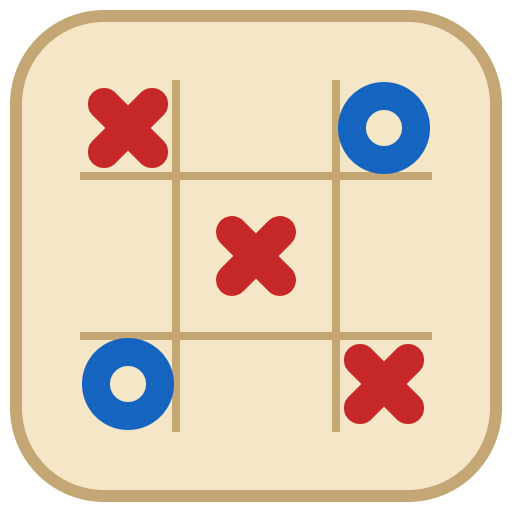

## Caro Online: Hệ thống thi đấu cờ ca rô trực tuyến (Client–Server)

---

## 🧑‍💻 THÔNG TIN NHÓM

| STT | Họ và Tên | MSSV | Email | Đóng góp |
|-----|-----------|------|-------|----------|
| 1 | Nguyễn Văn A | 20IT001 | a@example.com | ... |
| 2 | Trần Thị B | 20IT002 | b@example.com | ... |
| 3 | Lê Văn C | 20IT003 | c@example.com | ... |

**Tên nhóm:** Nhóm 01 – Lập trình mạng
**Chủ đề đã đăng ký:** Hệ thống thi đấu cờ ca rô trực tuyến sử dụng mô hình Client–Server

---

## 🧠 MÔ TẢ HỆ THỐNG

Người chơi đấu cờ ca rô 15×15 với nhau qua mạng. **Server quyết định mọi thứ**: kiểm tra nước đi, xác định
thắng/thua/hòa, đếm giờ từng lượt, tính điểm Elo và lưu lịch sử. Client chỉ gửi ý định ("tôi đi ô x,y")
và hiển thị những gì server gửi về.

Có hai loại client, dùng **chung một giao thức JSON** `{"type","reqId","data"}`:

- **Client desktop (bản Socket):** Java Swing, kết nối bằng **TCP thuần** (cổng 9090), mỗi thông điệp là một dòng JSON.
- **Client Web:** React + TypeScript. Dùng **WebSocket** (`/ws`) cho sảnh và trận đấu, **REST** (`/api`) cho đăng nhập,
  lịch sử, bảng xếp hạng và trang quản trị.

Hai loại client **đấu được với nhau trong cùng một trận**, vì chúng dùng chung một lõi xử lý trên server.

**Chức năng chính:**

| Nhóm | Chức năng |
|---|---|
| Tài khoản | Đăng ký, đăng nhập (JWT, mật khẩu băm BCrypt). Mỗi tài khoản chỉ một phiên: đăng nhập nơi khác sẽ đá phiên cũ |
| Sảnh | Danh sách phòng và người online cập nhật trực tiếp; tạo/vào phòng; **mời người chơi**; **tìm trận nhanh** theo Elo |
| Trận đấu | Bàn 15×15, 5 quân liên tiếp thắng, 30 giây mỗi lượt, đầu hàng, **chơi lại (đổi quân)** |
| Độ tin cậy | Heartbeat (PING 10 giây); mất mạng giữa trận thì trận **tạm dừng 30 giây** chờ người chơi tự kết nối lại |
| Dữ liệu | Elo (K=32), lịch sử đấu, **xem lại từng nước** của trận đã đấu, thống kê thắng/thua, bảng xếp hạng |
| Quản trị | Thống kê hệ thống, tìm/khóa/mở khóa tài khoản (người đang chơi bị đá ra ngay), xem phòng và trận |

**Sơ đồ hệ thống:**


Luật chơi chi tiết: [`source/docs/rules.md`](source/docs/rules.md) · Giao thức: [`source/docs/protocol.md`](source/docs/protocol.md)

---

## ⚙️ CÔNG NGHỆ SỬ DỤNG

| Thành phần | Công nghệ | Ghi chú |
|------------|-----------|---------|
| Server | Java 21 + Spring Boot 3.5 | TCP (`ServerSocket` + virtual threads), WebSocket thuần, REST, Spring Security + JWT |
| Database | PostgreSQL 17 + Flyway | Schema quản lý bằng migration, Spring Data JPA |
| Client desktop | Java 21 + Swing + FlatLaf, Jackson | `java.net.Socket`, tự kết nối lại |
| Client Web | React 18 + TypeScript + Vite | WebSocket + `fetch` (REST) |
| Triển khai | Docker Compose + nginx | `postgres`, `server`, `web` |
| Kiểm thử | JUnit 5, H2, Node test runner | Integration test qua socket thật (TCP và WebSocket) |

Thư viện ngoài đều được tải tự động: Maven Wrapper (`mvnw`, không cần cài Maven) cho Java và `npm` cho web.

---

## 🚀 HƯỚNG DẪN CHẠY DỰ ÁN

### Cách nhanh nhất: chạy toàn bộ bằng Docker

Yêu cầu: **Docker**.

```bash
git clone https://github.com/duckkthoi/caro-system.git
cd caro-system/source
docker compose up --build
```

| Địa chỉ | Dùng cho |
|---|---|
| http://localhost:5173 | **Client Web** (mở 2 tab hoặc 2 trình duyệt để chơi 2 người) |
| `localhost:9090` | Cổng TCP cho client desktop |
| http://localhost:8080/api/health | Kiểm tra server: `{"status":"ok",...}` |

Tài khoản admin có sẵn: `admin` / `admin123` (vào tab **Quản trị** trên web).

### Chạy client desktop

Yêu cầu: **JDK 21+**. Server phải đang chạy (bước trên).

```bash
cd source/client/desktop
./mvnw exec:java                      # Windows: mvnw.cmd exec:java
# hoặc build một file jar duy nhất rồi chạy:
./mvnw package && java -jar target/caro-desktop.jar
```

Muốn chơi qua mạng LAN thì nhập IP của máy chạy server vào ô **Server** trên màn hình đăng nhập.

### Chạy từng phần khi phát triển

```bash
cd source && docker compose up -d postgres          # chỉ bật database
cd source/server && ./mvnw spring-boot:run          # server: REST/WS :8080, TCP :9090
cd source/client/web && npm install && npm run dev  # web: http://localhost:5173 (tự chuyển /api, /ws tới :8080)
```

Chi tiết: [server](source/server/README.md) · [client desktop](source/client/desktop/README.md) ·
[client web](source/client/web/README.md).

### Kiểm thử

```bash
cd source/server && ./mvnw test                 # 42 test: luật chơi, Elo, ghép trận, integration qua TCP + WebSocket
cd source/client/desktop && ./mvnw test         # tầng kết nối với server giả
cd source/client/web && npm test                # logic bàn cờ phía client
```

---

## 🔗 GIAO TIẾP (GIAO THỨC SỬ DỤNG)

Đặc tả đầy đủ (mọi thông điệp, sự kiện, kiểu dữ liệu, mã lỗi): [`source/docs/protocol.md`](source/docs/protocol.md).

| Kênh | Protocol | Định dạng |
|------|----------|-----------|
| `host:9090` | TCP | Mỗi dòng một JSON `{"type","reqId","data"}`, kết thúc bằng `\n` |
| `ws://host:8080/ws` | WebSocket | Mỗi text frame một JSON, cùng định dạng với TCP |
| `http://host:8080/api` | HTTP/1.1 REST | JSON, xác thực bằng `Authorization: Bearer <JWT>` |

- Mỗi yêu cầu có một `reqId` và nhận về đúng một `OK` hoặc `ERROR` mang cùng `reqId`.
- Server cũng **tự đẩy sự kiện** (không có `reqId`), ví dụ `MOVE_APPLIED`, `MATCH_END`, `ROOM_LIST`, `INVITED`.

| Endpoint / Message | Protocol | Input | Output |
|----------|----------|-------|--------|
| `GET /api/health` | HTTP | (không có) | `{"status":"ok","onlineUsers","rooms"}` |
| `POST /api/auth/register` | HTTP | `{"username","password","displayName"?}` | `UserInfo` |
| `POST /api/auth/login` | HTTP | `{"username","password"}` | `{"token","user"}` |
| `LOGIN` / `AUTH` | TCP/WS | `{"username","password"}` / `{"token"}` | `OK {"token"?,"user"}` |
| `CREATE_ROOM` / `JOIN_ROOM` / `LEAVE_ROOM` | TCP/WS | `{"name"?}` / `{"roomId"}` / (không có) | `OK {"room"}` cùng các sự kiện `ROOM_LIST`, `ROOM_UPDATE` |
| `MOVE` | TCP/WS | `{"matchId","x","y"}` | `OK {"moveNo"}` cùng các sự kiện `MOVE_APPLIED`, `MATCH_END` |
| `RESIGN` | TCP/WS | `{"matchId"}` | `OK` cùng sự kiện `MATCH_END` |
| `PING` | TCP/WS | (không có) | `PONG {"serverTime"}` (heartbeat mỗi 10 giây) |
| `GET /api/users/{id}` · `GET_PROFILE` | HTTP · TCP/WS | `userId` | Hồ sơ, thống kê thắng/thua/hòa, hạng |
| `GET /api/users/{id}/matches` · `GET_HISTORY` | HTTP · TCP/WS | `userId`, `page`, `size` | Lịch sử đấu (phân trang) |
| `GET /api/matches/{id}` · `GET_MATCH` | HTTP · TCP/WS | `matchId` | Chi tiết trận và toàn bộ nước đi (xem lại ván) |
| `GET /api/leaderboard` · `GET_LEADERBOARD` | HTTP · TCP/WS | `page`, `size` | Bảng xếp hạng theo Elo |
| `LIST_ONLINE` | TCP/WS | (không có) | `OK {"users"}` cùng sự kiện `ONLINE_USERS` khi có thay đổi |
| `QUICK_MATCH` / `CANCEL_QUICK_MATCH` | TCP/WS | (không có) | Ghép trận ngẫu nhiên theo Elo: `QUEUE_STATUS`, rồi `MATCH_START` khi ghép được |
| `INVITE` / `INVITE_REPLY` / `CANCEL_INVITE` | TCP/WS | `{"userId"}` / `{"inviteId","accept"}` / `{"inviteId"}` | Mời người online: sự kiện `INVITED`, `INVITE_CLOSED` |
| `REMATCH` | TCP/WS | (không có) | Chơi lại khi cả hai đồng ý, đổi quân |
| `/api/admin/**` | HTTP | (role `ADMIN`) | Thống kê hệ thống, tìm/khóa/mở khóa tài khoản, xem phòng và trận |

**Một nước đi** (client desktop cầm X đấu client web cầm O):

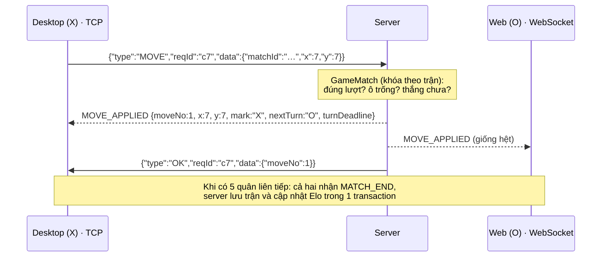

**Mất mạng giữa trận rồi kết nối lại:**

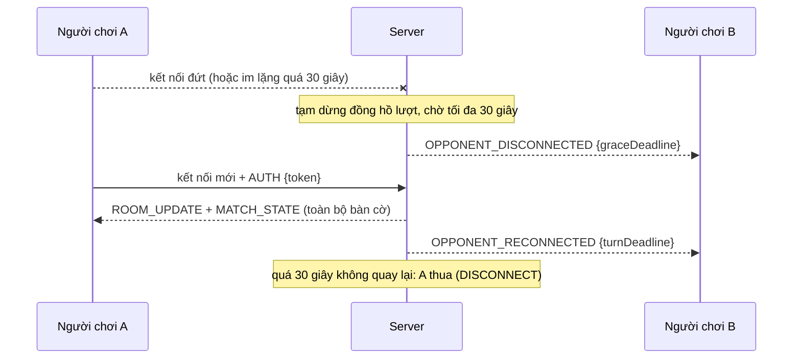

---

## 📊 KẾT QUẢ THỰC NGHIỆM

**Client desktop (Swing, TCP):** kết thúc ván với đường thắng được tô xanh, Elo đã cập nhật và đối thủ đang mời chơi lại.


| Client desktop | |
|---|---|
| 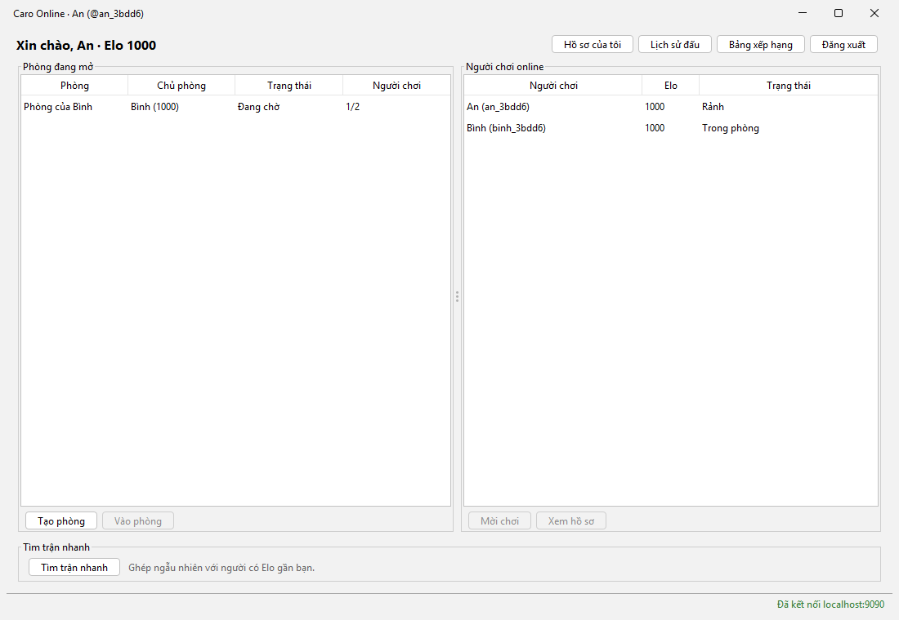 | 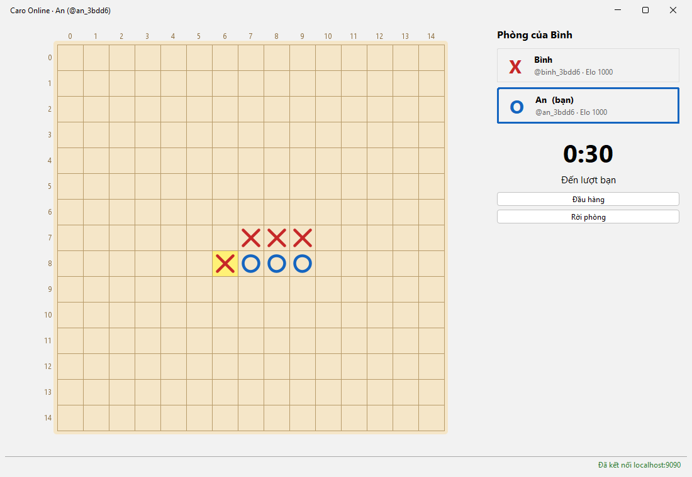 |
| Sảnh: phòng, người online, tìm trận nhanh | Đang chơi: đồng hồ 30 giây, nước vừa đi được tô vàng |
| 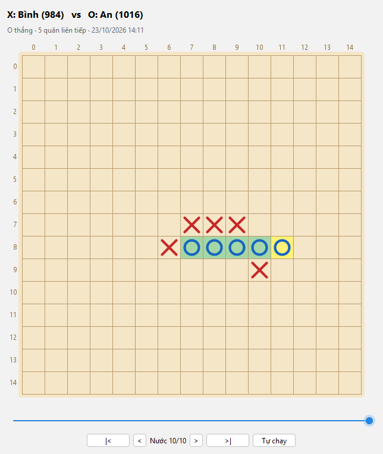 | 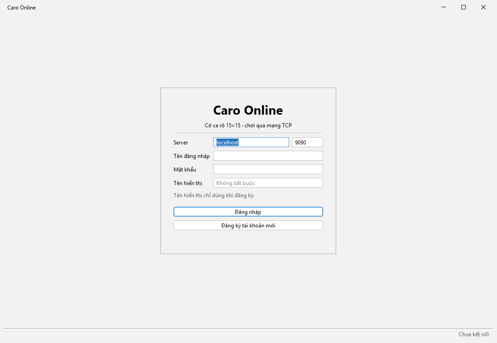 |
| Xem lại từng nước của trận đã đấu | Đăng nhập, chọn server |

| Client web (React, WebSocket + REST) | |
|---|---|
| 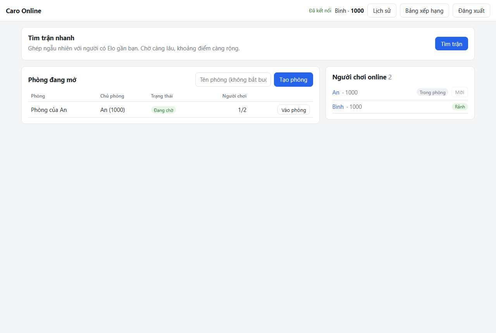 | 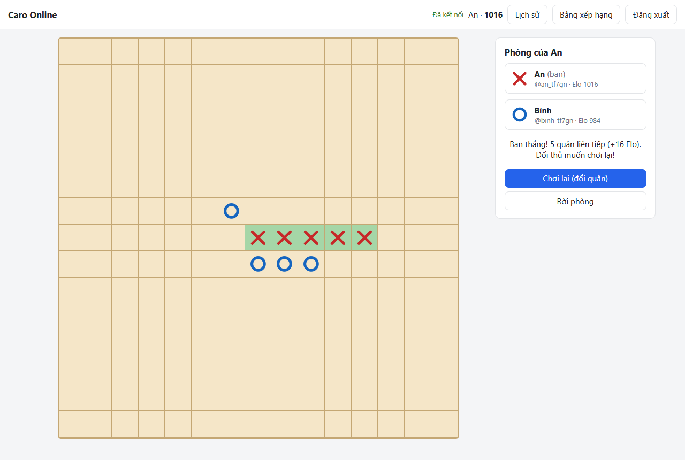 |
| Sảnh | Kết thúc ván, đối thủ muốn chơi lại |
| 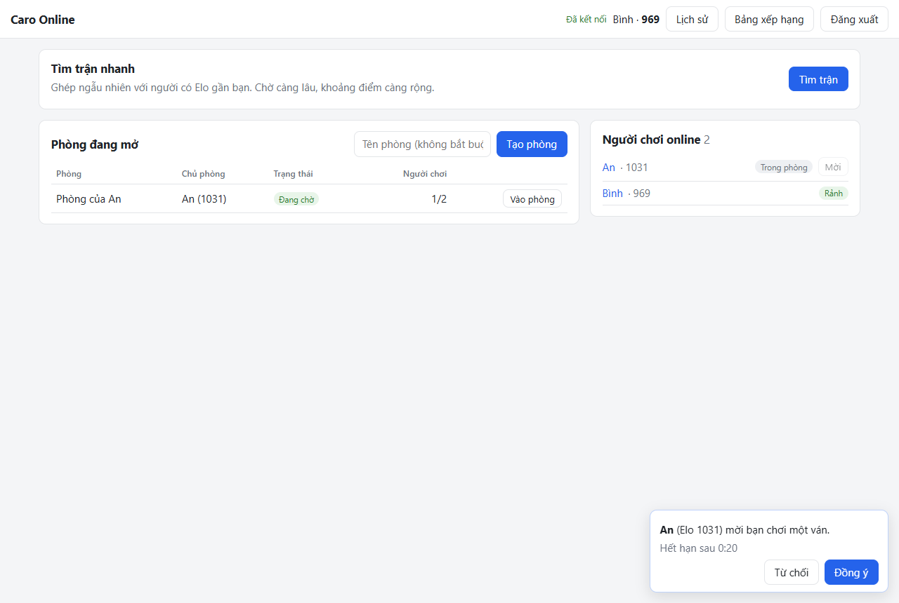 | 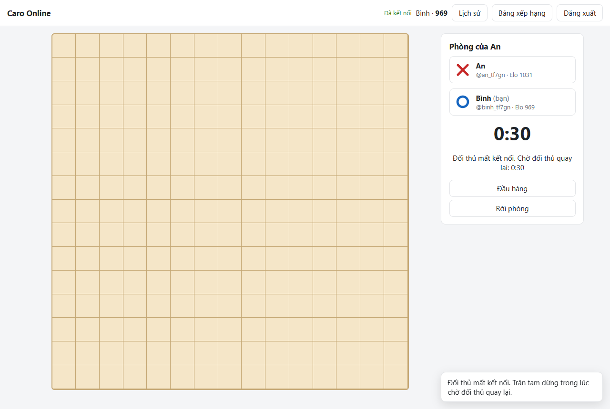 |
| Nhận lời mời (hết hạn sau 20 giây) | Đối thủ mất kết nối: trận tạm dừng, chờ 30 giây |
| 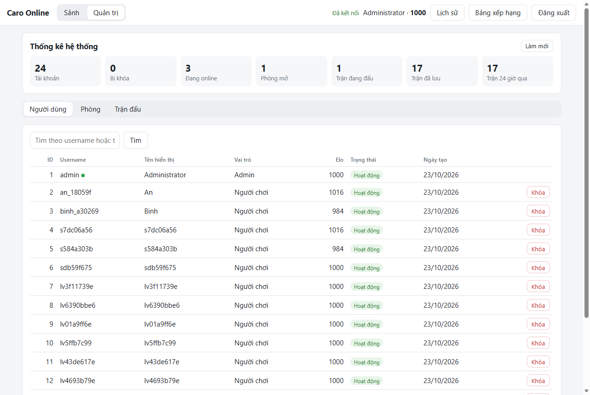 | 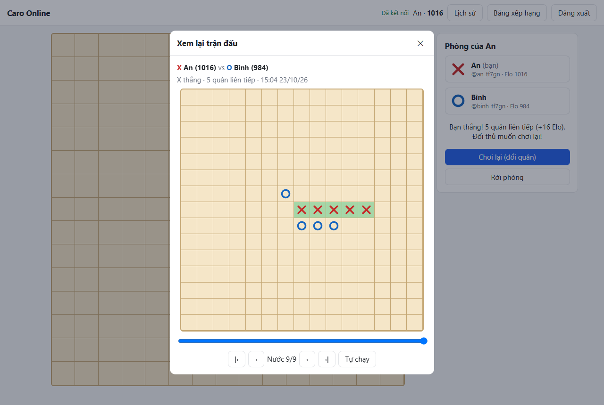 |
| Trang quản trị | Xem lại trận |

**Đã kiểm chứng:**
- Toàn bộ test tự động đều qua. Phía server có client TCP đấu với client WebSocket thật, kết nối lại giữa trận,
  ghép trận, lời mời, khóa tài khoản.
- Client desktop được chạy với server thật: ván đấu, chơi lại, kết nối lại, ghép trận.
- Client web được chạy trên trình duyệt thật: đăng ký, chơi, chơi lại, xem lại, mời, mất mạng rồi tự kết nối lại,
  trang quản trị. Không có lỗi trên console.
- Chạy với PostgreSQL thật qua Docker Compose.

---

## 🧩 CẤU TRÚC DỰ ÁN

```
caro-system/
├── README.md                    # tài liệu này
├── INSTRUCTION.md               # hướng dẫn của giảng viên (không sửa)
├── statics/                     # logo, sơ đồ hệ thống (diagram.png + diagram.html), ảnh chụp màn hình
└── source/
    ├── .gitignore
    ├── docker-compose.yml       # postgres + server + web
    ├── docs/
    │   ├── protocol.md          # đặc tả giao thức TCP / WebSocket / REST
    │   └── rules.md             # luật chơi và quy tắc nghiệp vụ
    ├── server/                  # Spring Boot (xem server/README.md)
    │   └── src/main/java/com/caro/server/
    │       ├── net/             # lõi giao thức; net/tcp (ServerSocket), net/ws (WebSocket)
    │       ├── lobby/           # phòng, danh sách online, ghép trận, lời mời, chơi lại
    │       ├── match/           # trận đấu (luật, đồng hồ, kết nối lại) và lưu kết quả
    │       ├── game/            # bàn cờ, kiểm tra 5 quân, Elo (Java thuần)
    │       ├── player/          # hồ sơ, lịch sử, bảng xếp hạng (REST + socket)
    │       ├── admin/           # API quản trị
    │       ├── auth/, user/     # tài khoản, JWT
    │       └── config/, common/
    └── client/
        ├── desktop/             # Java Swing, TCP (xem desktop/README.md)
        │   └── src/main/java/com/caro/client/{net,model,app,ui}/
        └── web/                 # React + TypeScript (xem web/README.md)
            └── src/{api,state,components,admin}/
```

---

## 🧩 HƯỚNG PHÁT TRIỂN THÊM

- [ ] Chat trong phòng (thông điệp `CHAT`), có lọc từ ngữ.
- [ ] Người xem trận (spectator) và phát lại trực tiếp cho người xem.
- [ ] Tùy chọn luật khi tạo phòng: chặn hai đầu, bàn 19×19, thời gian mỗi lượt.
- [ ] Bot đánh cùng máy để luyện tập.
- [ ] Giới hạn tần suất request (rate limit) để chống spam.
- [ ] Lưu trạng thái trận đang chơi (Redis) để server khởi động lại không mất trận, và chạy được nhiều instance.
- [ ] Gửi danh sách online dạng thay đổi (delta) thay vì cả danh sách, để chịu được nhiều người hơn.

---

## 📝 GHI CHÚ

- Repo tuân thủ đúng cấu trúc đã hướng dẫn trong `INSTRUCTION.md`.
- Server là nơi duy nhất quyết định kết quả. Trạng thái phòng và trận đang chơi chỉ nằm trong bộ nhớ server,
  nên khởi động lại server sẽ mất các trận đang diễn ra (các trận đã kết thúc đều nằm trong database).
- Máy Windows đã cài sẵn PostgreSQL sẽ bị trùng cổng 5432: xem cách xử lý trong [server/README.md](source/server/README.md).

---

## 📚 TÀI LIỆU THAM KHẢO

- Oracle, [Java Networking: Sockets](https://docs.oracle.com/javase/tutorial/networking/sockets/) và
  [Virtual Threads (JEP 444)](https://openjdk.org/jeps/444).
- [RFC 6455: The WebSocket Protocol](https://www.rfc-editor.org/rfc/rfc6455).
- [RFC 7519: JSON Web Token](https://www.rfc-editor.org/rfc/rfc7519).
- [Spring Boot](https://docs.spring.io/spring-boot/), [Spring WebSocket](https://docs.spring.io/spring-framework/reference/web/websocket.html),
  [Spring Security](https://docs.spring.io/spring-security/reference/).
- [Elo rating system](https://en.wikipedia.org/wiki/Elo_rating_system); cách ghép trận nới khoảng điểm theo thời gian
  chờ tham khảo từ [Lichess](https://lichess.org/).
- [React](https://react.dev/), [Vite](https://vite.dev/), [FlatLaf](https://www.formdev.com/flatlaf/).
