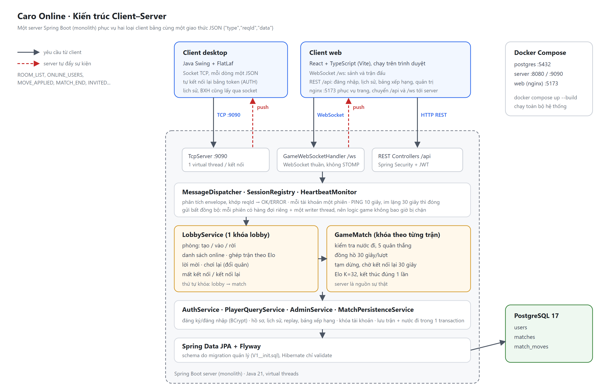
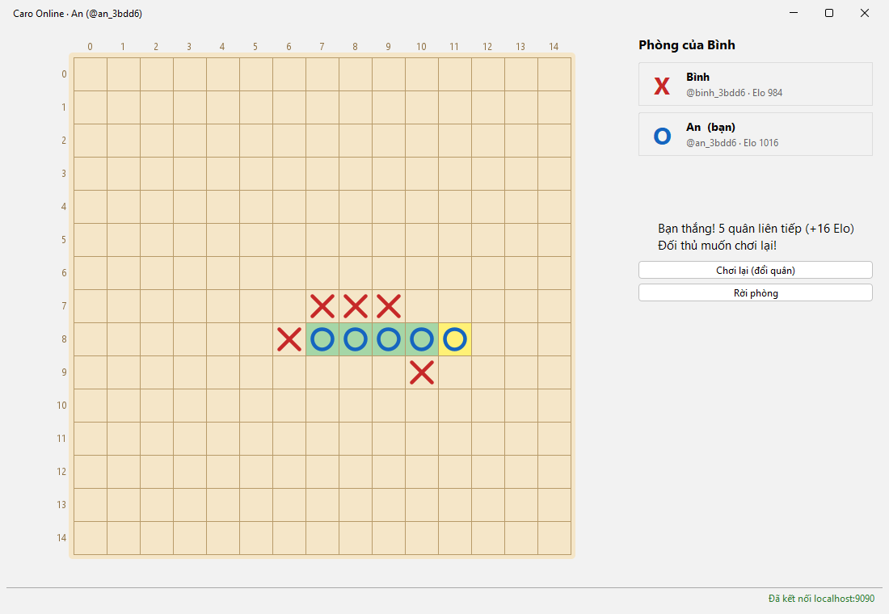

# BÀI TẬP LỚN: LẬP TRÌNH MẠNG  

## Caro Online: Hệ thống thi đấu cờ ca rô trực tuyến (Client–Server)

> 📘 *Mẫu README này là khung hướng dẫn. Sinh viên chỉ cần điền thông tin của nhóm và nội dung dự án theo từng mục.*

---

## 🧑‍💻 THÔNG TIN NHÓM

| STT | Họ và Tên | MSSV | Email | Đóng góp |
|-----|-----------|------|-------|----------|
| 1 | Nguyễn Văn A | 20IT001 | a@example.com | ... |
| 2 | Trần Thị B | 20IT002 | b@example.com | ... |
| 3 | Lê Văn C | 20IT003 | c@example.com | ... |

**Tên nhóm:** Nhóm 01 – Lập trình mạng  
**Chủ đề đã đăng ký:** Hệ thống thi đấu cờ ca rô trực tuyến sử dụng mô hình Client–Server

---

## 🧠 MÔ TẢ HỆ THỐNG

Hai người chơi đấu cờ ca rô 15×15 qua mạng. **Server quyết định mọi thứ**: kiểm tra nước đi, xác định thắng/thua/hòa,
tính điểm Elo, lưu lịch sử. Có hai loại client dùng **chung một giao thức JSON**:

- **Client desktop (bản Socket)** kết nối bằng **TCP thuần** (cổng 9090), mỗi thông điệp là một dòng JSON.
- **Client Web** kết nối bằng **WebSocket** (`/ws`) cho phần chơi, và **REST** (`/api`) cho tài khoản, lịch sử,
  bảng xếp hạng, quản trị.

Hai loại client có thể đấu với nhau trong cùng một trận.

**Cấu trúc logic tổng quát:**
```
Desktop client ──TCP :9090──┐
                            ├──►  Spring Boot server  ──►  PostgreSQL
Web client ──WS /ws + REST──┘     (một ứng dụng monolith)
```

**Sơ đồ hệ thống:**



Luật chơi chi tiết: [`source/docs/rules.md`](source/docs/rules.md)

---

## ⚙️ CÔNG NGHỆ SỬ DỤNG

| Thành phần | Công nghệ | Ghi chú |
|------------|-----------|---------|
| Server | Java 21 + Spring Boot 3.5 | TCP (`ServerSocket` + virtual threads), WebSocket, REST, Spring Security + JWT |
| Database | PostgreSQL 17 + Flyway | Schema quản lý bằng migration |
| Client desktop | (đang phát triển) | Kết nối TCP |
| Client Web | (đang phát triển) React + TypeScript | WebSocket + REST |
| Triển khai | Docker Compose | `postgres` + `server` |

---

## 🚀 HƯỚNG DẪN CHẠY DỰ ÁN

Yêu cầu: Docker. Nếu muốn chạy server ngoài Docker thì cần thêm JDK 21+ (không cần cài Maven).

### 1. Clone repository
```bash
git clone <repository-url>
cd jnp-project-starter
```

### 2. Chạy server
```bash
cd source
docker compose up --build          # PostgreSQL + server: REST/WS :8080, TCP :9090
```
Hoặc khi dev: `docker compose up -d postgres`, sau đó `cd server && ./mvnw spring-boot:run`.
Xem chi tiết trong [`source/server/README.md`](source/server/README.md).

### 3. Chạy client
```bash
cd source/client
# (sẽ bổ sung khi có client desktop và web)
```

### 4. Kiểm thử nhanh
```bash
curl http://localhost:8080/api/health          # {"status":"ok",...}
cd source/server && ./mvnw test                # unit test + integration test (TCP và WebSocket)
```

---

## 🔗 GIAO TIẾP (GIAO THỨC SỬ DỤNG)

Đặc tả đầy đủ: [`source/docs/protocol.md`](source/docs/protocol.md).

| Kênh | Protocol | Định dạng |
|------|----------|-----------|
| `host:9090` | TCP | Mỗi dòng một JSON `{"type","reqId","data"}`, kết thúc bằng `\n` |
| `ws://host:8080/ws` | WebSocket | Mỗi text frame một JSON, cùng định dạng với TCP |
| `http://host:8080/api` | HTTP/1.1 REST | JSON, xác thực bằng `Authorization: Bearer <JWT>` |

| Endpoint / Message | Protocol | Input | Output |
|----------|----------|-------|--------|
| `GET /api/health` | HTTP | (không có) | `{"status":"ok","onlineUsers","rooms"}` |
| `POST /api/auth/register` | HTTP | `{"username","password","displayName"?}` | `UserInfo` |
| `POST /api/auth/login` | HTTP | `{"username","password"}` | `{"token","user"}` |
| `LOGIN` / `AUTH` | TCP/WS | `{"username","password"}` / `{"token"}` | `OK {"token"?,"user"}` |
| `CREATE_ROOM` / `JOIN_ROOM` / `LEAVE_ROOM` | TCP/WS | `{"name"?}` / `{"roomId"}` / (không có) | `OK {"room"}` cùng các sự kiện `ROOM_LIST`, `ROOM_UPDATE` |
| `MOVE` | TCP/WS | `{"matchId","x","y"}` | `OK {"moveNo"}` cùng các sự kiện `MOVE_APPLIED`, `MATCH_END` |
| `RESIGN` | TCP/WS | `{"matchId"}` | `OK` cùng sự kiện `MATCH_END` |
| `PING` | TCP/WS | (không có) | `PONG {"serverTime"}` (heartbeat mỗi 10 giây) |
| `GET /api/users/{id}` · `GET_PROFILE` | HTTP · TCP/WS | `userId` | Hồ sơ, thống kê thắng/thua/hòa, hạng |
| `GET /api/users/{id}/matches` · `GET_HISTORY` | HTTP · TCP/WS | `userId`, `page`, `size` | Lịch sử đấu (phân trang) |
| `GET /api/matches/{id}` · `GET_MATCH` | HTTP · TCP/WS | `matchId` | Chi tiết trận và toàn bộ nước đi (xem lại ván) |
| `GET /api/leaderboard` · `GET_LEADERBOARD` | HTTP · TCP/WS | `page`, `size` | Bảng xếp hạng theo Elo |
| `LIST_ONLINE` | TCP/WS | (không có) | `OK {"users"}` cùng sự kiện `ONLINE_USERS` khi có thay đổi |
| `QUICK_MATCH` / `CANCEL_QUICK_MATCH` | TCP/WS | (không có) | Ghép trận ngẫu nhiên theo Elo: `QUEUE_STATUS`, rồi `MATCH_START` khi ghép được |
| `INVITE` / `INVITE_REPLY` / `CANCEL_INVITE` | TCP/WS | `{"userId"}` / `{"inviteId","accept"}` / `{"inviteId"}` | Mời người online: sự kiện `INVITED`, `INVITE_CLOSED` |
| `REMATCH` | TCP/WS | (không có) | Chơi lại khi cả hai đồng ý, đổi quân |
| `/api/admin/**` | HTTP | (role `ADMIN`) | Thống kê hệ thống, tìm/khóa/mở khóa tài khoản, xem phòng và trận |

---

## 📊 KẾT QUẢ THỰC NGHIỆM

> Đưa ảnh chụp kết quả hoặc mô tả log chạy thử.



---

## 🧩 CẤU TRÚC DỰ ÁN

```
jnp-project-starter/
├── README.md
├── INSTRUCTION.md
├── statics/                     # hình ảnh, sơ đồ
└── source/
    ├── .gitignore
    ├── docker-compose.yml       # postgres + server
    ├── docs/
    │   ├── protocol.md          # đặc tả giao thức TCP/WebSocket/REST
    │   └── rules.md             # luật chơi và quy tắc nghiệp vụ
    ├── server/                  # Spring Boot (xem server/README.md)
    │   ├── pom.xml, mvnw, Dockerfile
    │   └── src/main/java/com/caro/server/
    │       ├── net/             # lõi giao thức, net/tcp, net/ws
    │       ├── lobby/           # phòng, danh sách online, ghép trận, lời mời, chơi lại
    │       ├── match/           # trận đấu và lưu kết quả
    │       ├── player/          # hồ sơ, lịch sử, bảng xếp hạng (REST + socket)
    │       ├── admin/           # API quản trị
    │       ├── game/            # bàn cờ, luật thắng, Elo
    │       ├── auth/, user/     # tài khoản, JWT
    │       └── config/, common/
    └── client/                  # client desktop và web (đang phát triển)
```

---

## 🧩 HƯỚNG PHÁT TRIỂN THÊM

> Nêu ý tưởng mở rộng hoặc cải tiến hệ thống.

- [ ] Cải thiện giao diện người dùng
- [ ] Thêm tính năng xác thực và phân quyền
- [ ] Tối ưu hóa hiệu suất
- [ ] Triển khai trên cloud

---

## 📝 GHI CHÚ

- Repo tuân thủ đúng cấu trúc đã hướng dẫn trong `INSTRUCTION.md`.
- Đảm bảo test kỹ trước khi submit.

---

## 📚 TÀI LIỆU THAM KHẢO

> (Nếu có) Liệt kê các tài liệu, API docs, hoặc nguồn tham khảo đã sử dụng.